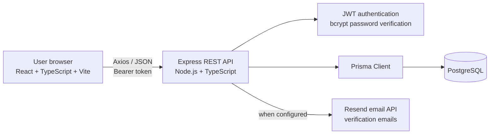
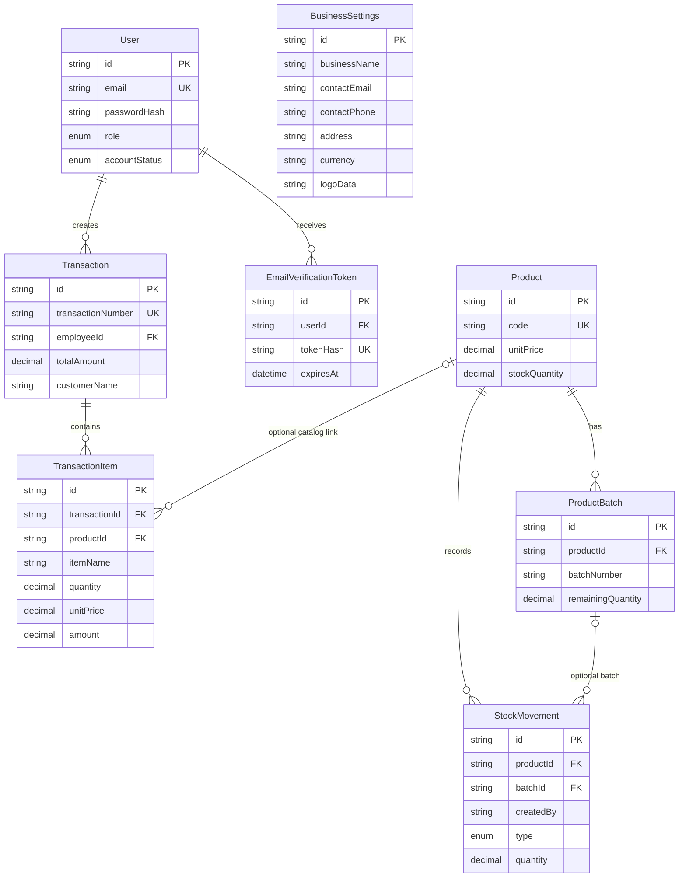

# BizManager

BizManager is a web-based business management system for recording sales, creating customer invoices, managing a product catalog and stock, and reviewing sales activity. It is designed for business owners and administrators who oversee operations, and employees who record day-to-day transactions.

The application brings sales and inventory records into one PostgreSQL-backed system. It helps reduce manual invoice calculations, keep a record of who created each sale, maintain product stock quantities, and review sales by employee and date range.

> **Scope note:** Despite the repository's historical name, the current application is primarily a sales and inventory system. It has stock receiving and adjustment APIs, but it does not currently provide a purchase-order, supplier-ledger, or accounts-payable workflow.

## Table of contents

- [Features](#features)
- [Implemented scope and limitations](#implemented-scope-and-limitations)
- [Roles and permissions](#roles-and-permissions)
- [Technology stack](#technology-stack)
- [Architecture](#architecture)
- [Repository structure](#repository-structure)
- [Installation and setup](#installation-and-setup)
- [Environment variables](#environment-variables)
- [Database design](#database-design)
- [API documentation](#api-documentation)
- [Using BizManager](#using-bizmanager)
- [Security](#security)
- [Testing and troubleshooting](#testing-and-troubleshooting)
- [Future improvements](#future-improvements)
- [License and credits](#license-and-credits)

## Features

### Authentication and account management

- Admin and employee login through the same login page.
- Role-based access checks in both the React application and Express API.
- JWT bearer-token authentication; tokens expire after eight hours.
- Admin-managed employee creation, editing, suspension, and reactivation.
- Employee accounts created by an Admin are active, email-verified, and required to change their temporary password at first login.
- Password changes require the current password and enforce a 12-character minimum with uppercase, lowercase, numeric, and symbol characters.
- Email verification and resend-verification API flows, with configurable Resend email delivery.
- One-time Admin provisioning that refuses to create an Admin if an Admin already exists.

There is no public sign-up page or API endpoint in the current application.

### Dashboard

The dashboard page displays sales total, transaction count, active product count, and active employee count. Sales totals and transaction counts are scoped to the signed-in employee unless the user is an Admin; product and employee counts are business-wide.

The dashboard API response also includes low-stock and out-of-stock counts, expiring and expired batch counts, and inventory value. These additional metrics are not currently displayed on the dashboard page.

### Invoices and sales

- Create invoices with customer name, phone, and address.
- Add invoice lines by manually entering item names and prices, or by selecting an active catalog product.
- Keep manual and catalog item drafts while switching entry methods.
- Calculate each line amount, subtotal, and total from quantity and unit price. New and updated invoices have no discount or tax applied.
- Save invoices with a transaction number, creator, payment status, and payment method.
- View, search, filter, and edit saved invoices, subject to ownership and inventory-history checks.
- Preview invoices and print the preview or saved invoice using the browser's print dialog.
- Optionally include the business logo on a print operation; the per-print option starts off.
- Use the browser print dialog's **Save as PDF** destination to download a PDF.

Selecting a product preserves its product relationship and deducts stock. Manual items do not require a catalog product and do not affect stock.

### Products and inventory

- Admins can add, edit, search, and deactivate products in the Products page.
- Product fields in the data model include name, code, SKU, barcode, category, unit, selling price, cost price, stock quantity, minimum and target stock, and expiry tracking.
- Authenticated users can view active products and inventory information.
- Backend APIs support product batches, purchase receipts, stock movements, and inventory listings.
- Product-based invoice sales record stock movements and reduce product stock. Expiry-tracked products are checked against available non-expired batches.

The current frontend Products page does not expose the batch-receiving or manual stock-movement APIs as interactive workflows; these are API capabilities.

### Customer information

Invoices capture customer name, phone, and address. These values are stored on each transaction as invoice details. There is no separate customer model, customer directory, or customer CRUD page.

### Reports

- Sales report with optional start and end dates.
- Transaction count and sales total.
- Sales totals and transaction counts grouped by employee.
- Employees see their own sales; Admins see organization-wide sales.
- Invoice list/search is available separately under Invoices and Search Records.

Reports use saved transaction totals. Historical totals are not recalculated when the current invoice form changes.

### Business settings

Admins can manage the business name, email, phone, address, currency, invoice display preferences, and uploaded business logo. Logos accept PNG, JPEG, or WebP images up to 2 MB. Invoice printing can include the saved logo when **Show Business Logo** is enabled for that print.

## Implemented scope and limitations

The following items should not be mistaken for completed application features:

| Area | Current implementation |
|---|---|
| Purchases | Batch receipt and stock-movement API endpoints exist; no purchase-order or supplier purchase ledger UI exists. |
| Customer management | Customer details are stored on invoices; there is no separate customer records module. |
| PDF export | There is no PDF-generation library or server-side PDF endpoint. “Download PDF” opens the browser print flow; the user can choose Save as PDF. |
| Invoice sharing | A Share Invoice button is displayed, but it has no implemented action. |
| Inventory workflows | Product stock is visible and editable in Products; batch receipt and movement APIs are not wired into the current page UI. |
| Saved settings preferences | Business contact, logo, and payment display preferences are stored. The print templates use the per-print logo checkbox; the saved contact/payment visibility preferences are not applied by the templates. |
| Admin role assignment | Employee management does not grant Admin permissions to employees. Admin provisioning is a separate protected script. |
| Automated tests | No test script or test files are defined in the package manifests. |

Invoice rows retain legacy discount and tax database columns for compatibility with existing records. New and updated invoices save those values as zero, and their totals are calculated directly from line items. Existing financial records are not rewritten.

## Roles and permissions

The API is authoritative for permissions; hiding a frontend control is not a substitute for server-side authorization.

| Capability | Admin | Employee |
|---|---:|---:|
| View dashboard summary | Yes; all sales | Yes; own sales summary, with business-wide product/employee/inventory counts |
| Create invoices | Yes | Yes |
| List, search, view, and edit invoices | All employees' invoices | Own invoices only |
| View products and inventory | Yes | Yes |
| Create, edit, deactivate products | Yes | No |
| Receive stock batches or record movements | Yes, through API | No |
| View sales reports | All employees | Own sales |
| Create, edit, suspend, and reactivate employee accounts | Yes | No |
| View and update business settings | Yes | No |
| Change own password | Yes | Yes |

Employee creation currently sets the role to `EMPLOYEE`; the employee interface does not offer a role selector.

## Technology stack

| Layer | Technologies used |
|---|---|
| Frontend | React 18, TypeScript, Vite, React Router, Axios |
| Backend | Node.js, Express 4, TypeScript |
| Database | PostgreSQL; configuration supports a PostgreSQL/Supabase database |
| ORM and migrations | Prisma 6 and Prisma Client |
| Authentication | bcrypt password hashing, signed JWT bearer tokens, server-side role checks |
| Validation | Zod request and environment validation |
| Styling | Tailwind CSS 3 with application CSS |
| Icons | lucide-react |
| Email | Resend for verification email delivery |
| Printing | Browser print styles and `window.print()` |

There is no dedicated PDF or invoice-sharing library in the current implementation. Recharts and React Hook Form packages are listed in the frontend dependencies but are not currently imported by the application source.

## Architecture

The React application calls the Express API over HTTP using Axios. Authenticated requests send the JWT using the standard HTTP bearer authorization scheme. Express validates request data, checks authentication/roles, then uses Prisma Client to query PostgreSQL. Prisma migrations define additive schema changes.



## Repository structure

```text
.
├── backend/
│   ├── prisma/
│   │   ├── migrations/       # Versioned PostgreSQL schema migrations
│   │   ├── schema.prisma     # Models, relations, enums, and data source
│   │   └── seed.ts           # Optional demo account seed
│   ├── src/
│   │   ├── config/           # Environment and Prisma client setup
│   │   ├── controllers/      # API request handlers
│   │   ├── middleware/       # Authentication, rate limits, and errors
│   │   ├── routes/           # Express route definitions
│   │   ├── services/         # Email delivery
│   │   ├── utils/            # HTTP errors and async handlers
│   │   ├── validators/       # Zod schemas
│   │   ├── app.ts            # Express middleware and route mounting
│   │   ├── provision-admin.ts
│   │   └── reset-admin.ts
│   └── package.json
├── frontend/
│   ├── src/
│   │   ├── components/       # Shared shell and UI components
│   │   ├── context/          # Authentication state
│   │   ├── pages/            # Dashboard, invoices, products, reports, settings
│   │   ├── services/         # Axios API client
│   │   ├── types/            # Shared frontend types
│   │   └── App.tsx           # Routes and route guards
│   ├── index.html
│   ├── vite.config.ts
│   └── package.json
├── package.json              # npm workspaces and root scripts
├── package-lock.json
├── CUSTOMER_HANDOVER.md      # Operational and deployment notes
└── README.md
```

## Installation and setup

### Requirements

- Windows 10/11 with PowerShell.
- Node.js 20 or later and npm.
- PostgreSQL 14 or later, or a PostgreSQL-compatible Supabase project.
- A Resend account and verified sender address only if email verification is enabled.

### 1. Clone and install

```powershell
git clone https://github.com/Abdullahi-Suugani/BizManager-.git
Set-Location .\BizManager-
npm install
```

### 2. Configure the backend environment

Create `backend\.env` (it is ignored by Git) and set the variables described in [Environment variables](#environment-variables). Example shape:

```dotenv
DATABASE_URL="postgresql://<user>:<password>@<host>:5432/<database>?sslmode=require"
DIRECT_URL="postgresql://<user>:<password>@<direct-host>:5432/<database>?sslmode=require"
JWT_SECRET="<a-random-secret-at-least-16-characters-long>"
PORT=4000
FRONTEND_URL="http://localhost:5173"
ALLOWED_ORIGINS=""
EMAIL_FROM="BizManager <noreply@example.com>"
EMAIL_VERIFICATION_REQUIRED=false
VERIFICATION_TOKEN_TTL_MINUTES=60
# RESEND_API_KEY is needed when EMAIL_VERIFICATION_REQUIRED=true.
```

Use your database provider's connection values. For Supabase, use the pooled connection string for `DATABASE_URL` where appropriate and the direct PostgreSQL connection for `DIRECT_URL` so Prisma can run migrations. URL-encode special characters in database credentials. Do not commit `.env` files.

For local development without an email provider, set `EMAIL_VERIFICATION_REQUIRED=false`. In production, configure a valid Resend API key and a verified `EMAIL_FROM` sender.

### 3. Configure the frontend API URL

Create `frontend\.env`:

```dotenv
VITE_API_URL="http://localhost:4000/api"
```

If unset, the frontend API client defaults to `http://localhost:4000/api`.

### 4. Generate Prisma Client and migrate

```powershell
npm run prisma:generate
npx prisma migrate deploy --schema .\backend\prisma\schema.prisma
```

`migrate deploy` applies the checked-in migrations without resetting the database. For a brand-new database it creates the schema; for an existing database it applies pending additive migrations. Never use `prisma migrate reset` with business data.

The Prisma datasource uses both `DATABASE_URL` and `DIRECT_URL`; configure both before generating or migrating. Current migrations cover initial accounts/transactions, verification, products/settings, invoice fields, password-change flags, inventory tracking, and invoice/logo fields.

### 5. Provision the first Admin (only if needed)

The provisioner creates one Admin only if no Admin exists. It does not change an existing Admin account. Provide `ADMIN_EMAIL` and `ADMIN_PASSWORD` securely in the process environment; the password must be at least 12 characters. `ADMIN_NAME` is optional.

For a local PowerShell session, enter the password without echoing it:

```powershell
$env:ADMIN_EMAIL = Read-Host "Admin email"
$securePassword = Read-Host "Admin password" -AsSecureString
$env:ADMIN_PASSWORD = [System.Net.NetworkCredential]::new("", $securePassword).Password
$env:ADMIN_NAME = Read-Host "Admin display name"
npm run provision:admin --workspace backend
Remove-Item Env:ADMIN_EMAIL, Env:ADMIN_PASSWORD, Env:ADMIN_NAME
```

Run this only against the intended database. If an Admin already exists, sign in with that account instead.

### 6. Start the application

Run both services together from the repository root:

```powershell
npm run dev
```

Or start them in separate PowerShell windows:

```powershell
npm run dev --workspace backend
```

```powershell
npm run dev --workspace frontend
```

The API listens on `http://localhost:4000` by default; Vite listens on `http://localhost:5173`.

### 7. Build

```powershell
npm run build
```

## Environment variables

Never put production credentials in source control, screenshots, issues, or README examples. `.env` files are ignored by this repository's `.gitignore`.

### Backend runtime (`backend\.env`)

| Variable | Required | Description |
|---|---:|---|
| `DATABASE_URL` | Yes | PostgreSQL connection used by the running API. |
| `DIRECT_URL` | Yes for Prisma commands | Direct PostgreSQL connection used by the Prisma schema for migrations and direct database operations. |
| `JWT_SECRET` | Yes | Secret used to sign and verify JWTs; at least 16 characters, and should be a unique high-entropy value. |
| `PORT` | No | API port; defaults to `4000`. |
| `FRONTEND_URL` | No | Main allowed frontend origin and email verification link origin; defaults to `http://localhost:5173`. |
| `ALLOWED_ORIGINS` | No | Additional comma-separated frontend origins allowed by CORS. |
| `EMAIL_VERIFICATION_REQUIRED` | No | `true` or `false`; defaults to `true`. |
| `RESEND_API_KEY` | Conditional | Required when email verification is enabled. Keep private. |
| `EMAIL_FROM` | Yes | Valid email sender or `Name <email>` format; use a sender authorized by Resend in production. |
| `VERIFICATION_TOKEN_TTL_MINUTES` | No | Verification token lifetime in minutes; defaults to `60`. |

The API appends `sslmode=require` to database URLs when an SSL mode is not already specified.

### Frontend (`frontend\.env`)

| Variable | Required | Description |
|---|---:|---|
| `VITE_API_URL` | No | API base URL, normally `http://localhost:4000/api` locally and the deployed API `/api` URL in production. |

Vite variables are bundled into frontend assets. Do not put secrets in variables prefixed with `VITE_`.

### Optional account scripts

These are only read by the corresponding scripts and are not needed for normal application startup:

| Variable | Used by | Description |
|---|---|---|
| `ADMIN_NAME` | `provision:admin` | Optional name for a new initial Admin. |
| `ADMIN_EMAIL` | `provision:admin` | Email for the initial Admin; provisioning refuses if any Admin already exists. |
| `ADMIN_PASSWORD` | `provision:admin` | Initial Admin password; minimum 12 characters. Never log or commit it. |
| `ADMIN_RESET_EMAIL` | `reset:admin` | Existing Admin email that must match before a confirmed password reset. |
| `ADMIN_RESET_PASSWORD` | `reset:admin` | New password for a confirmed reset; minimum 12 characters. |
| `ADMIN_RESET_CONFIRM` | `reset:admin` | Must equal `YES` to perform the reset; without it, the script only prints a limited status preview. |
| `SEED_ADMIN_EMAIL` | `prisma:seed` | Optional demo seed Admin email. |
| `SEED_ADMIN_PASSWORD` | `prisma:seed` | Optional demo seed Admin password. |
| `SEED_EMPLOYEE_PASSWORD` | `prisma:seed` | Optional shared demo seed employee password. |

The seed script creates demo users and is intended only for a disposable development database. The reset script targets `DIRECT_URL`; double-check that it points to the intended database before use.

## Database design

All primary IDs are Prisma-generated CUID strings unless noted. Monetary and quantity values use PostgreSQL `DECIMAL` columns to avoid storing currency as floating-point values.

| Model | Purpose and key relationships |
|---|---|
| `User` | Unique email, password hash, role, verification/account status, and password-change flag. One user can create many `Transaction` records and have many verification tokens. |
| `EmailVerificationToken` | Stores a unique token hash, expiry and use timestamps; belongs to a `User` and is deleted if that user is deleted. |
| `Transaction` | Unique transaction number, customer snapshot, total/payment fields, timestamps, and required employee relation. Employee deletion is restricted while transactions refer to the employee. |
| `TransactionItem` | Invoice line with item name, quantity, unit price, amount, optional product relation, and transaction relation. Transaction deletion cascades to its items; product deletion sets the optional product link to null. |
| `Product` | Unique product code, catalog attributes, prices, stock quantity, and expiry-tracking configuration. Related to invoice items, batches, and stock movements. |
| `ProductBatch` | Received quantity, remaining quantity, cost, supplier, and optional expiry date. Belongs to a product; `(productId, batchNumber)` is unique. |
| `StockMovement` | Records stock event type, quantity, reason/reference, creator ID, and optional product batch. |
| `BusinessSettings` | Singleton-style settings row with default ID `default`, business contact details, currency, display preferences, and optional logo data. |

`Role`, `AccountStatus`, and `StockMovementType` are PostgreSQL enums generated by Prisma. Foreign keys preserve transaction/item/product and inventory relationships; indexes support transaction dates, product names/status, item names, and stock history.



## API documentation

The API is mounted at `/api`. Except for login and email-verification operations, endpoints below require a JWT bearer authorization header. Admin-only endpoints additionally require the authenticated user's current database role to be `ADMIN`.

### Authentication and health

| Method and path | Access | Purpose |
|---|---|---|
| `GET /health` | Public | Checks API/database availability; returns `200` with database `ok` or `503` if unavailable. |
| `POST /api/auth/login` | Public; rate-limited | Authenticate an active, verified user. |
| `POST /api/auth/verify-email` | Public; rate-limited | Verify an email using its token. |
| `POST /api/auth/resend-verification` | Public; rate-limited | Resend verification when required. |
| `GET /api/auth/me` | Authenticated | Return the current user. |
| `POST /api/auth/logout` | Authenticated | Acknowledge logout; the browser clears its locally stored token. |
| `POST /api/auth/change-password` | Authenticated | Change the current user's password. |

Login request:

```json
{
  "email": "employee@example.com",
  "password": "<password>"
}
```

Login response:

```json
{
  "token": "<jwt>",
  "user": {
    "id": "<user-id>",
    "name": "Employee",
    "email": "employee@example.com",
    "role": "EMPLOYEE",
    "mustChangePassword": true
  }
}
```

Change-password request:

```json
{
  "currentPassword": "<current-password>",
  "newPassword": "<new-password-meeting-policy>"
}
```

Verification request bodies are `{"token":"<verification-token>"}` and `{"email":"employee@example.com"}` for verify and resend, respectively. Responses contain a `message`.

### Dashboard and reports

| Method and path | Access | Query | Response |
|---|---|---|---|
| `GET /api/dashboard/summary` | Authenticated | None | Sales total/count, active product/employee counts, stock/expiry counts, and inventory value. |
| `GET /api/reports/sales` | Authenticated | Optional `from=YYYY-MM-DD`, `to=YYYY-MM-DD` | `from`, `to`, `transactionCount`, `salesTotal`, and `byEmployee[]`. |

Date ranges are inclusive. The end date must be on or after the start date.

### Invoices and transactions

| Method and path | Access | Query/body | Response |
|---|---|---|---|
| `POST /api/transactions` | Authenticated | Customer/payment fields and at least one invoice item | `201` with `{ "transaction": ... }`. |
| `GET /api/transactions` | Authenticated | Optional filters below | `{ "transactions": [...], "pagination": {...} }`. |
| `GET /api/transactions/:id` | Authenticated; own invoice for Employee | Invoice ID | `{ "transaction": ... }`. |
| `PUT /api/transactions/:id` | Authenticated; own invoice for Employee | Same item/customer body as create | Updated `{ "transaction": ... }`. |

List filters: `invoiceNumber`, `employeeId` (Admin only), `item`, `from`, `to`, `page`, and `pageSize` (1–100; defaults to page 1 and 20 rows).

Create/update request:

```json
{
  "customerName": "Example Customer",
  "customerPhone": "+1 555 0100",
  "customerAddress": "Example address",
  "isPaid": false,
  "paymentMethod": "Cash",
  "items": [
    {
      "itemName": "Consulting service",
      "quantity": 2,
      "unitPrice": 50
    },
    {
      "productId": "<existing-product-cuid>",
      "itemName": "Catalog product",
      "quantity": 1,
      "unitPrice": 25
    }
  ]
}
```

For a catalog item, the API verifies the active product and uses its stored name and price; stock is checked and deducted. Manual lines omit `productId`. The API calculates each line amount and total from saved item lines. Legacy discount and tax fields are retained in the database, but new and updated invoices store zero values for them. An older product invoice without invoice-linked stock history cannot be edited safely and returns `409`.

### Employees

All employee endpoints require Admin authorization.

| Method and path | Purpose |
|---|---|
| `GET /api/employees` | List employee accounts. |
| `POST /api/employees` | Create an active employee; password is hashed and must be changed at first login. |
| `PATCH /api/employees/:id` | Update name, email, password, or account status (`ACTIVE`/`SUSPENDED`). |
| `POST /api/employees/:id/deactivate` | Suspend an employee account. |

Create request example:

```json
{
  "name": "New Employee",
  "email": "new.employee@example.com",
  "password": "<temporary-password>"
}
```

The response contains the employee record but never returns the password.

### Products and inventory

All routes below require authentication. Product writes, batch receipts, and stock movements require Admin authorization.

| Method and path | Purpose |
|---|---|
| `GET /api/products` | List/search products. Optional `search`, `includeInactive=true`, and `lowStock=true` query parameters. |
| `POST /api/products` | Create a product. |
| `PUT /api/products/:id` | Replace product fields using the product schema. |
| `DELETE /api/products/:id` | Deactivate/archive a product; it is not hard-deleted. |
| `GET /api/products/inventory` | Return active products, expiring batches, and recent movements; optional `days` query parameter (up to 365). |
| `POST /api/products/batches` | Receive a product batch and increase stock. |
| `POST /api/products/movements` | Record a return, damage, expiry, or adjustment stock movement. |

Product create example:

```json
{
  "name": "Example product",
  "code": "ITEM-001",
  "unitPrice": 25,
  "stockQuantity": 10
}
```

Batch receipt requires `productId`, `batchNumber`, `receivedQuantity`, and `purchaseCost`; `receivedDate`, `expirationDate`, and `supplier` are optional. A movement requires `productId`, `type`, and positive `quantity`; optional fields include `batchId` and `reason`.

### Business settings

| Method and path | Access | Purpose |
|---|---|---|
| `GET /api/settings/invoice` | Authenticated | Return settings needed for invoice display, including business name, logo, contact fields, and currency. |
| `GET /api/settings` | Admin | Return business settings. |
| `PUT /api/settings` | Admin | Save business name/contact/currency/display preferences and optional logo data URI. |

The uploaded logo is stored as a PNG, JPEG, or WebP data URI. Keep request images within the 2 MB UI upload limit.

### Errors

API errors use JSON such as:

```json
{
  "message": "A concise error description"
}
```

Common statuses:

| Status | Meaning |
|---:|---|
| `400` | Invalid request or validation failure. |
| `401` | Missing, invalid, or expired authentication. |
| `403` | Account is not verified/approved or lacks the required role. |
| `404` | Route or requested invoice/product/employee was not found. |
| `409` | Duplicate account/product, unavailable product, insufficient stock, or unsafe legacy invoice edit. |
| `429` | Authentication/verification rate limit exceeded. |
| `500` | Unexpected server error. |
| `503` | Database health or verification email service is unavailable. |

Login is limited to 10 attempts per IP/path per 15 minutes; email verification to 10 per 15 minutes; resend verification to 3 per hour. These limits are in-memory and apply per API process.

## Using BizManager

1. **Sign in.** Use the Admin account provisioned for your database or an employee account created by an Admin. Employees with temporary passwords must change them at first login.
2. **Review the dashboard.** Check sales, transaction count, and active product/employee counts. Inventory and expiry counts are available in the dashboard API response but are not currently displayed in the page.
3. **Create employee accounts (Admin).** Open Employees, enter a name/email and temporary password (or generate one), and share the temporary password securely. Employees must change it on first login.
4. **Manage products (Admin).** Open Products to add/edit product name, code, price, and stock, search the catalog, and deactivate products.
5. **Create an invoice.** Open New Invoice, enter customer details, and use either Write Items Manually or Select Existing Products. Enter quantities and manual prices or select catalog items. Total equals the sum of line amounts.
6. **Save and preview.** Save the invoice to assign its transaction number, then open the preview. Saved invoices can be found through Invoices or Search Records.
7. **Print or download.** Choose whether to show the business logo, then select Print Invoice or Download PDF. Download PDF opens the browser print dialog; select **Save as PDF** there.
8. **Manage business information (Admin).** Open Settings to update business contact details, currency, logo, and saved preferences. The per-print logo checkbox starts off each print.
9. **Review reports.** Open Reports, optionally set a date range, and review the sales total and per-employee results.

## Security

- Passwords are stored as bcrypt hashes (12 rounds); password values are not returned by the employee API.
- Login uses signed JWT access tokens with an eight-hour expiry. The frontend stores the token in browser `localStorage` and attaches it as a bearer token.
- The API looks up the current user and active account status on authenticated requests, then checks roles on Admin-only routes.
- Zod schemas validate authentication, invoice, product, employee, report, and settings input.
- Email-verification tokens are generated with cryptographic randomness and stored as SHA-256 hashes with expirations.
- CORS is restricted to `FRONTEND_URL` and explicit `ALLOWED_ORIGINS`.
- Configure secrets only in local ignored environment files or a trusted deployment secret manager. Never expose backend secrets through `VITE_` variables.
- Use TLS-protected PostgreSQL connections and least-privilege database credentials. Back up the database before production migrations.
- Sharing an Admin password makes activity attribution less reliable and increases exposure risk. Prefer individual accounts; the current UI does not yet support granting Admin role to an employee.

## Testing and troubleshooting

### Available checks

No automated test runner or test files are currently defined in the workspace packages. The available project validation commands are:

```powershell
npm run build
npx prisma validate --schema .\backend\prisma\schema.prisma
```

For a local service smoke check after starting the API:

```powershell
Invoke-RestMethod http://localhost:4000/health
```

The health response should report `"database":"ok"`.

### Common problems

| Problem | Checks and resolution |
|---|---|
| Backend exits during startup | Confirm `backend\.env` exists and has `DATABASE_URL`, a `JWT_SECRET` of at least 16 characters, and a valid `EMAIL_FROM`. If verification is enabled, configure `RESEND_API_KEY`. |
| Prisma cannot connect or migrate | Verify both database URLs and network access. Use a direct PostgreSQL URL for `DIRECT_URL`; verify TLS requirements and credentials. Run `npm run prisma:generate` followed by `npx prisma migrate deploy --schema .\backend\prisma\schema.prisma`. |
| Prisma reports migration drift | Inspect migration status and database history; back up first. Do not use `migrate reset` on customer data. |
| Frontend requests the wrong API | Set `frontend\.env` `VITE_API_URL` to `http://localhost:4000/api`, then restart Vite. |
| CORS error | Set `FRONTEND_URL` to the exact frontend origin (scheme, host, and port) and restart the API. Add other trusted origins to `ALLOWED_ORIGINS`. |
| Port already in use | Change `PORT` for the backend or stop the correct existing development process after identifying it. Set the frontend's Vite port in `frontend/vite.config.ts` if needed. |
| Verification email does not arrive | Confirm Resend API key, verified sender/domain, `EMAIL_FROM`, and `FRONTEND_URL`. For development without email, disable required verification only in the local environment. |
| Product invoice is rejected for stock | Check product activity, available stock, and expiry-tracked non-expired batch quantities. |
| Browser cannot generate a PDF | Use Print Invoice or Download PDF and choose **Save as PDF** in the browser's print destination. A separate PDF library is not included. |
| Prisma Client generation fails on Windows with `EPERM` | A process may have a Prisma query-engine DLL locked. Close running Node/BizManager processes and retry `npm run prisma:generate`; do not delete or reset the database. |

## Future improvements

No formal roadmap or planned features are defined in the repository. The gaps listed in [Implemented scope and limitations](#implemented-scope-and-limitations) describe current behavior, not committed plans.

## License and credits

No license file or license declaration was found in the repository; no license is asserted here. The application uses the open-source packages listed in the root, frontend, and backend `package.json` files.
